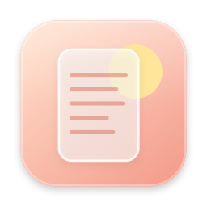

# Paperlight



**A tiny Mac menu bar app that makes your screen easier on the eyes: softer contrast, a warm paper-like tint and gentle dimming.**


### [⬇️ Download Paperlight](https://github.com/hi-dad/paperlight/releases/latest/download/Paperlight.dmg)
Free · macOS 13 or newer · always the latest version

## Install

1. Open **Paperlight.dmg** and drag Paperlight into **Applications**.
2. Open it, and click **Open** when macOS asks if you're sure. (It's signed and checked by Apple.)

## How to use it

- Click the **book icon** in your menu bar and flip the switch on.
- **Contrast:** softer like paper, or sharper for faint text. **Warmth:** a cozy tint with less blue light. **Brightness:** dims below the normal minimum.
- Save up to four looks in the slots and switch with one click.
- **⌃⌥R** turns it on or off from anywhere.

## Safe by design

No special permissions, no system settings changed. Quit it and your screen goes straight back to normal.

**Updates:** it offers new versions itself (or book icon → **Updates…**). **Remove:** book icon → **Quit**, then drag it to the Trash.

<details><summary>Build it yourself</summary>

Needs the Xcode Command Line Tools (`xcode-select --install`).

```bash
./build.sh        # builds, installs to Applications and opens it
./build.sh dist   # also makes dist/Paperlight.dmg
```

</details>

MIT License
