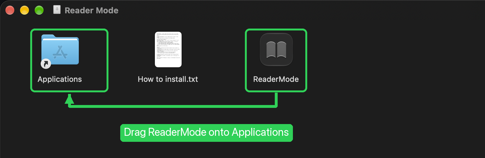
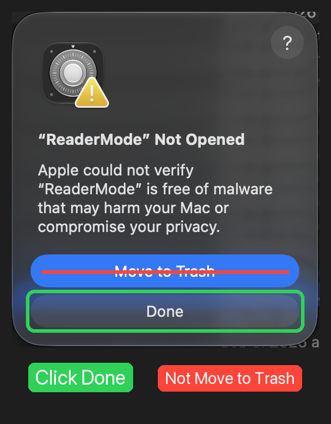
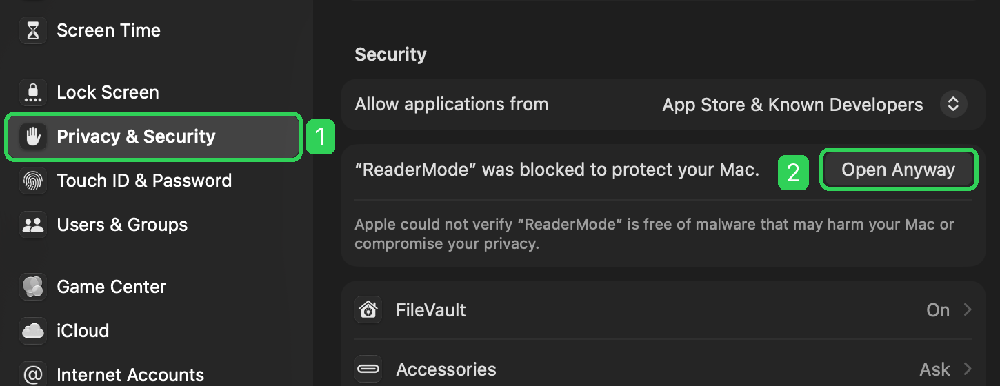

# Reader Mode

A tiny Mac menu bar app that makes your screen easier to read — softer contrast, a warm paper-like tint, and gentle dimming. Inspired by the "Reader" picture mode on LG monitors.

## ⬇️ [Download Reader Mode for Mac](https://github.com/dsryan8197/reader-mode/releases/latest/download/ReaderMode.dmg)

Works on macOS 13 (Ventura) or newer, on both Apple Silicon and Intel Macs.

## Install

1. Open the downloaded **ReaderMode.dmg**.
2. Drag **ReaderMode** onto the **Applications** folder in that window. (Don't open it from inside this window.)

   

3. Open **Applications** and double-click **Reader Mode**.

### The first time you open it

Your Mac will say it can't verify the app. That's normal for apps that aren't from the App Store, and you only need to do this once.

1. Click **Done**. Don't click Move to Trash.

   

2. Open **System Settings**, click **Privacy & Security**, scroll down, and click **Open Anyway** next to ReaderMode. Enter your Mac password if asked.

   

3. Click **Open** on the last prompt. From now on Reader Mode opens normally.

If you don't see **Open Anyway**, try opening Reader Mode once more, then go straight back to Privacy & Security. The button only appears for about an hour after the app is blocked.

## How to use it

- Click the **📖 book icon** in your menu bar (top right of the screen).
- Flip the switch to turn Reader Mode on.
- Adjust the sliders:
  - **Contrast**: left = softer (less glare, like paper), right = sharper (faint text stands out).
  - **Warmth**: adds a cozy yellow tint and reduces blue light.
  - **Brightness**: dims the screen beyond the normal setting.
- **Four slots (Favorite, #2, #3, #4)**: click one, adjust the sliders, press **Save**. Click a slot any time to switch to it.
- **⌃⌥R** (Control + Option + R) turns it on or off from anywhere.
- **Only laptop screen** leaves external monitors alone.
- **Open at login** starts it automatically.

## Is it safe?

Yes. It doesn't change any system settings, and it doesn't need your password or special permissions. It uses the same standard macOS feature that apps like f.lux use to adjust screen colors. Quit the app (or restart your Mac) and your screen goes straight back to normal.

**To uninstall:** click the book icon → **Quit**, then drag Reader Mode from Applications to the Trash.

## Build it yourself

You need the Xcode Command Line Tools (`xcode-select --install`).

```bash
./build.sh        # builds and installs to /Applications
./build.sh dist   # also makes dist/ReaderMode.dmg
```

The whole app is one file: [`main.swift`](main.swift).

## License

[MIT](LICENSE)
